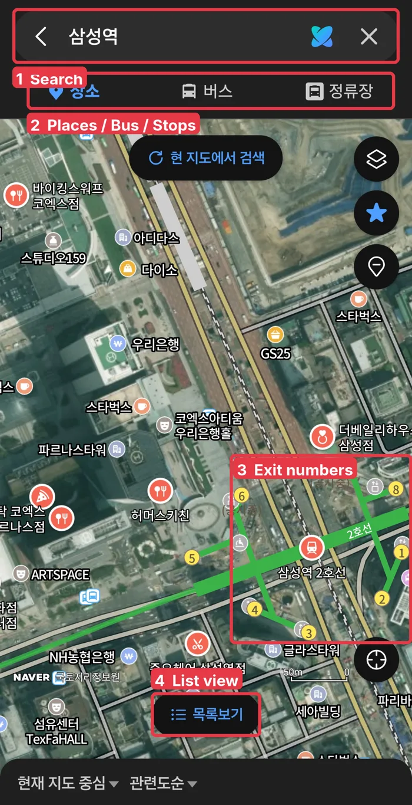
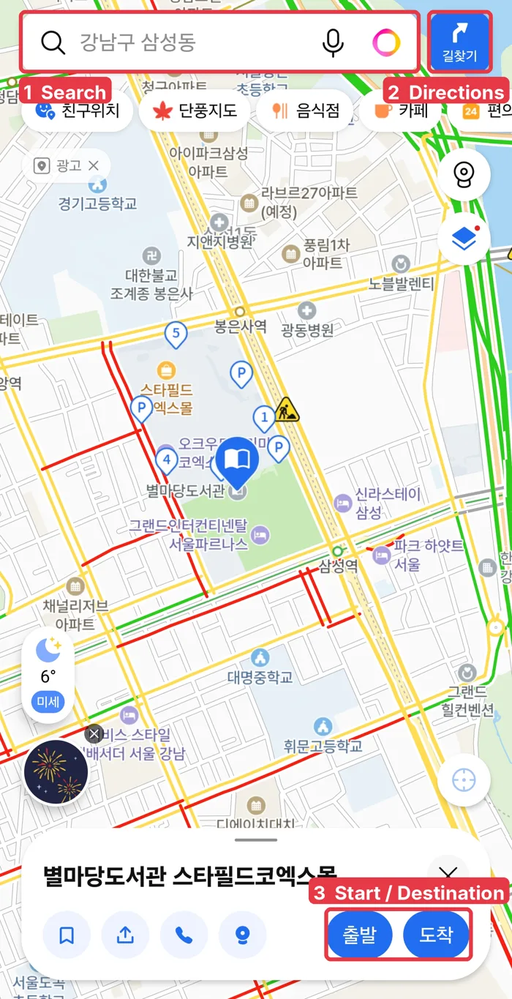

If you open Google Maps in Seoul, you'll find places fine, but directions are often missing or incomplete. Korea limits how detailed map data can leave the country, so Google's routing here has long been weaker than at home.

That's why almost everyone in Korea uses **Naver Map** or **Kakao Map** to get around, and **Kakao T** to call a taxi. This guide walks through each app with real screens, labeled in English.

## Which app for what

| You want to…                                    | Best app  | English menu?                    |
| ----------------------------------------------- | --------- | -------------------------------- |
| Find a place and get subway/bus/walk directions | Naver Map | **Yes**, in Settings             |
| A second opinion on routes and places           | Kakao Map | Partly, some text stays Korean   |
| Call a taxi                                     | Kakao T   | Mostly Korean (see k.ride below) |
| Call a taxi in English with a foreign card      | k.ride    | **Yes**, built for foreigners    |

## Naver Map: your main app

Naver Map is the one to install first. It covers subway, bus, walking and driving routes, and you can switch the app to English.

**Switch to English:** open the **MY** tab, then **Settings → Language → English**. On iPhone you can also go to the phone's **Settings → NAVER Map → Preferred Language**. Menu names can shift a little between app versions.

Here is what a search for a subway station looks like (this one is Samseong Station, in Korean mode):

1. **Search:** type the place name. English works, but if you have the Korean name (copy it from a website or message), paste that. It is more accurate.
2. **Places / Bus / Stops** (장소 / 버스 / 정류장): switch between places, bus routes and bus stops.
3. **Exit numbers:** the small numbered circles around the station are **exit numbers**. Korean stations are big, and people meet at a specific exit, like "Exit 5." Check which exit is closest to where you are going before you leave the platform.
4. **List view** (목록보기): shows the results as a list instead of pins.

Tip: when a Korean friend says "meet at Samseong Station Exit 5," search the station and look for the circle with 5.

## Kakao Map: a good backup

Kakao Map does the same job and many Koreans prefer it. Its English support is more limited, so some menus and reviews stay in Korean. It's still worth knowing the main buttons:

1. **Search:** type a place name. English names work for well-known places.
2. **Directions** (길찾기): opens route search.
3. **Start / Destination** (출발 / 도착): after you tap a place, choose whether it's where you start or where you're going. The app then shows subway, bus, car and walking options.

The row of buttons under the search bar are quick filters: 음식점 (restaurants), 카페 (cafés), 편의점 (convenience stores).

## Kakao T: calling a taxi

Kakao T is Korea's main taxi app. Drivers all over the country use it. The catch for visitors is that it's mostly in Korean, and some features can ask for a **Korean phone number**.

1. **Where to?** (어디로 갈까요?): tap here and type your destination. 집 is "Home" and 회사 is "Work," for saved places.
2. **Service tabs:** 이동할 때 (getting around), 운전할 때 (driving), 물건보낼 때 (sending items), 해외갈 때 (going abroad).
3. **Taxi** (택시): calls a taxi. Next to it: 바이크 (bike), 대리 (a designated driver who drives your car), 퀵·배송 (courier).

### If Kakao T doesn't work for you: k.ride

In June 2024 Kakao Mobility, the company behind Kakao T, launched **k.ride**, a taxi app made for foreign visitors. According to [Korea JoongAng Daily](https://www.koreajoongangdaily.com/business/kakao-mobilitys-kride-taxi-app-offers-live-translation-for-foreign-travelers/12251248):

- The app is in **English, Chinese and Japanese**, with built-in translation for chatting with the driver.
- You can sign up with **email, Google or Apple**, and pay with an **overseas credit card**.
- It only offers higher-grade taxi types, so fares are a bit **higher than a regular Kakao T taxi**.

If you live in Korea and have a Korean phone number, regular Kakao T is usually cheaper. If you're visiting, k.ride is the easier start.

## Korean words you'll see

| Korean | Meaning                      |
| ------ | ---------------------------- |
| 출발   | Start / departure            |
| 도착   | Destination / arrive         |
| 길찾기 | Directions                   |
| 출구   | Exit                         |
| ~호선  | Subway line (2호선 = Line 2) |
| 정류장 | Bus stop                     |
| 택시   | Taxi                         |

## Summary

- Install **Naver Map** first and switch it to English in **MY → Settings → Language**.
- When meeting someone at a station, always check the **exit number**.
- Use **Kakao Map** as a backup with the same Start / Destination idea.
- For taxis, try **Kakao T**; if it asks for a Korean phone number, use **k.ride** with your foreign card.

Screenshots: taken by ZIN Money on an Android phone in November 2026. App screens change over time.

Sources checked: [Korea JoongAng Daily on k.ride](https://www.koreajoongangdaily.com/business/kakao-mobilitys-kride-taxi-app-offers-live-translation-for-foreign-travelers/12251248), [Trip.com Naver Map guide](https://sg.trip.com/guide/phone/naver-map.html), [Wise: How to use Naver Map in English](https://wise.com/sg/blog/naver-map), [Trip.com k.ride guide](https://sg.trip.com/guide/phone/k.ride-app.html), [Koreabridge Kakao Map guide](https://www.koreabridge.net/post/how-use-kakao-map-english-complete-guide-foreigners-2026).
